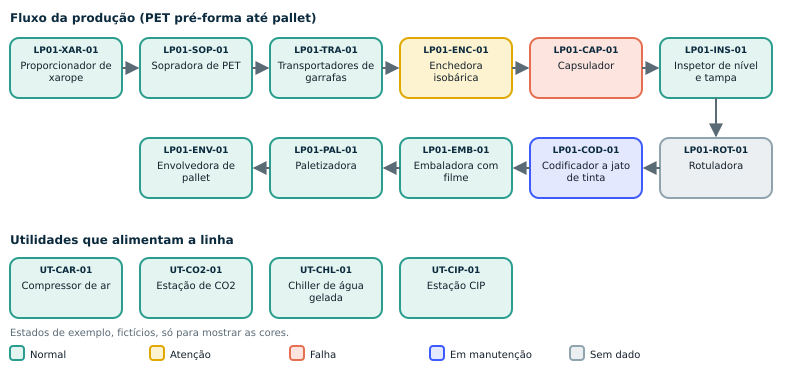

# 🏭 Holofix — Linha, Gêmeo Digital e Rotas
### Resumo direto · Linha 01: envase PET de refrigerante carbonatado

**Data:** 17/10/2026 · ⚠ Linha-modelo para o piloto; ajustar à planta real.

## 🗺️ As 4 rotas (na ordem do fluxo)

| Rota | Quando | Paradas | Pontos | Tempo ⚠ |
|---|---|---|---|---|
| **R1** Abertura de turno: linha inteira | Início do turno e após parada longa | Compressor de ar › Estação de CO2 › Estação CIP › Proporcionador de xarope › Sopradora de PET › Transportadores de garrafas › Enchedora isobárica › Capsulador › Inspetor de nível e tampa › Rotuladora › Codificador a jato de tinta › Embaladora com filme termoencolhível › Paletizadora › Envolvedora de pallet | 33 | ~64 min |
| **R2** Utilidades e CIP | Duas vezes por turno (hipótese) | Compressor de ar › Estação de CO2 › Chiller de água gelada › Estação CIP | 9 | ~18 min |
| **R3** Pontos críticos: meio de turno | A cada 2 a 3 horas (hipótese) | Compressor de ar › Proporcionador de xarope › Sopradora de PET › Transportadores de garrafas › Enchedora isobárica › Capsulador › Inspetor de nível e tampa › Rotuladora › Codificador a jato de tinta › Embaladora com filme termoencolhível › Paletizadora | 19 | ~40 min |
| **R4** Fechamento e passagem de turno | Fim do turno | Linha | 3 | ~6 min |

⚠ Tempo = 1,5 min por ponto + 1 min por parada. A medir no piloto.

## 🚦 Estado de cada máquina no gêmeo digital

| Cor | Quando |
|---|---|
| 🔵 Em manutenção | Ordem de serviço em andamento (bloqueio ativo) |
| 🔴 Falha | Ponto marcado Falha, ou chamado urgente aberto |
| 🟡 Atenção | Ponto marcado Atenção, ou número fora da faixa |
| ⚪ Sem dado | Sem ronda no prazo (1,5 vez o intervalo ⚠) |
| 🟢 Normal | Última ronda toda OK e nada aberto |

## ✅ Regras de campo

1. **QR em cada máquina**: o técnico confirma onde está; o reconhecimento por imagem é só apoio.
2. **Sem internet, a ronda continua** e sobe quando a rede voltar.
3. **LOTO manda**: os óculos não substituem bloqueio e etiquetagem.
4. **Só olhar, ouvir e ler painel**: nunca mexer em máquina em movimento.
5. **Fora de escopo**: sala de amônia e áreas classificadas.

## ☑️ Validar com o cliente
- [ ] Máquinas reais da linha e a ordem
- [ ] Layout físico (ajusta a ordem das rotas)
- [ ] Faixas aceitáveis de pressão, temperatura e Brix (manual do fabricante)
- [ ] Onde óculos e câmera são permitidos
